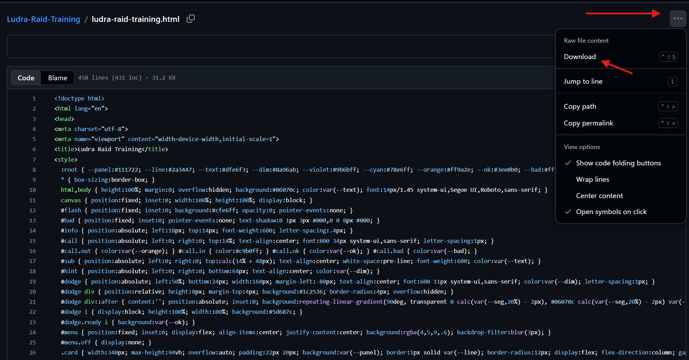

# Ludra Raid Training

A free 3D practice tool for **Ludra**, the boss of the Sanctuary raid in AION 2. Practise two of her mechanics with a
real third-person camera, at full or reduced speed, as many times as you like:

- **Zikel:** the orange lines, the laser walls and the hard-mode circles.
- **Bingo board** (phase 1): sweep the board with 9 bot teammates, find the safe square, dodge Ludra's two breaths
  and get inside before the meteor lands.

Made by **mtkです [Siel] · South America**.

## ▶ [Click here to play](https://mtkkk.github.io/Ludra-Raid-Training/)

**That's all you need to do: click the link above.** The trainer opens in your web browser and you can start right
away. Nothing to download, nothing to install, no account needed.

Link to share: **https://mtkkk.github.io/Ludra-Raid-Training/**

Use a computer with a keyboard and mouse, in Chrome, Edge or Firefox.

> **Unofficial fan project.** Made by players, for players. Not affiliated with, endorsed by or connected to NCSOFT.
> AION is a trademark of NCSOFT. No game files, art or sounds are used: everything you see is drawn with simple
> original shapes.

## Want your own copy instead? (optional)

You don't need this to play: the link at the top is enough. Download only if you want to keep the file on your
computer. You only need **one file**: `ludra-raid-training.html`.

**[⬇ Download ludra-raid-training.html](https://github.com/mtkkk/Ludra-Raid-Training/releases/latest/download/ludra-raid-training.html)**

Click the link above, then double-click the downloaded file in your Downloads folder. It opens in your browser and
the trainer starts. This link always gives you the newest version.

### Or from the file page

1. **Open the file page:** click **[ludra-raid-training.html](ludra-raid-training.html)**. You'll see a page full of
   code. That's normal, you don't need to read it.
2. **Find the download button:** click the **`···`** button at the **top right** of that page.
3. **Click "Download".** The file saves to your Downloads folder.

   

4. **Open it:** go to your Downloads folder and double-click `ludra-raid-training.html`. It opens in your web
   browser and the trainer starts.

If it opens in a different program instead (like Notepad), right-click the file, choose **Open with**, and pick
**Chrome**, **Edge** or **Firefox**.

You need an internet connection while playing, because the page loads its 3D library when it opens.

> The green **Code** button → **Download ZIP** on the main page also works, but it downloads the whole project as a
> ZIP that you have to unzip first. The steps above are simpler.

## Controls

| Key | Action |
|---|---|
| `W` `A` `S` `D` | Move (relative to the camera) |
| Mouse | Look around (click the screen to capture the mouse) · wheel zooms |
| `Shift` | Dodge (uses stamina: a full bar is 5 dodges) |
| `Space` | Jump (Bingo board: jump into your orb) |
| `R` or `Enter` | Restart |
| `Esc` | Menu |

The menu lets you pick **Normal** or **Hard** mode, slow the fight down to 50% or 75%, change mouse sensitivity, turn
on-screen callouts on or off, and keep playing after a mistake to see everything you missed.

## The mechanics in short

**Zikel.** Ludra (north) flies back and four orange lines appear one after another, every 4 seconds, always in the
same order. Stay off a line while it is orange, step onto it once it strikes, and be on it when the rest of the room
detonates. Between lines, a wall of lasers sweeps across the room: stand in a gap. On hard mode, an orange circle also
drops under your feet; be out of it (or perfect dodge) when it fills.

**Bingo board.** A 6 × 6 board appears and a circle follows every player four times; each one fills the square it
lands on. Pick your corner and role (outside, inside, or centre for the orbs) and sweep your squares with the team
until someone finds the hidden safe square, then everyone runs inside it: it makes you immune. Twice, Ludra flies to
a corner and breathes across the board along the diagonal; hold the far corner of your square or wait at the edge.
When "Ludra's Trial" ends, a meteor kills everyone outside the safe square.

The full breakdowns, with every timing and how it was measured, are in
[`ludra-zikel-mechanic.md`](ludra-zikel-mechanic.md) and [`ludra-bingo-mechanic.md`](ludra-bingo-mechanic.md). They
are written so anyone can build their own trainer from them.

## Open source: use it, share it, improve it

Anyone can use this tool, share it with their static or legion, and improve on it.

- **Found a wrong timing or a missing detail?** Open an issue, ideally with a video link and timestamp.
- **Want to change something?** Fork the repository and send a pull request. All mechanic timings and sizes are in
  the `CFG` block at the top of the script in `ludra-raid-training.html`, so most fixes are a one-line change.
- **Building your own tool?** Take whatever you need, including the mechanic reference.

## Files

| File | What it is |
|---|---|
| `ludra-raid-training.html` | The trainer: one self-contained page |
| `ludra-zikel-mechanic.md` | Zikel reference: rules, timings, sources, open questions |
| `ludra-bingo-mechanic.md` | Bingo board reference: rules, timings, the common solve, open questions |
| `PROGRESS.md` | Development notes |
| `index.html` | Sends the website address straight to the trainer |
| `docs/` | Images for this README |
| `LICENSE` | MIT license |

## Credits

Created by **mtkです** of the **[Siel]** server (South America), with mechanic timings checked frame by frame against
raid videos. The teammates in the Bingo board trainer carry the names of mtkです's guildmates.

## License

[MIT](LICENSE): free to use, change and share, including in your own projects, as long as the license notice stays
with the code.
